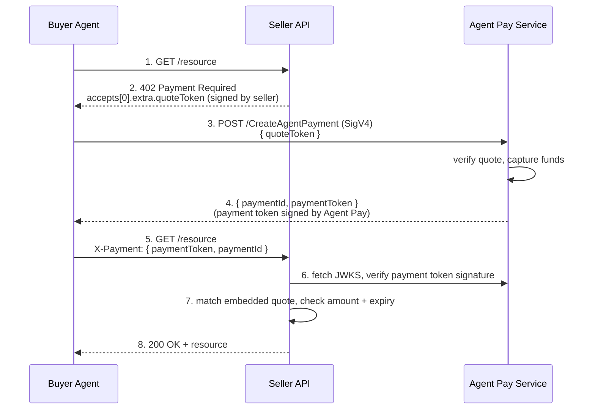

# Payment Flow

The Agent Pay x402 payment flow involves three parties: the **buyer** (an AI agent), the
**seller** (a resource service), and the **Agent Pay service** (the AWS Marketplace
provider that authorizes and captures payments).

## Sequence



## ASCII version

```
Buyer Agent                    Seller API                  Agent Pay Service
     |                              |                              |
     |  1. GET /resource            |                              |
     |----------------------------->|                              |
     |                              |                              |
     |  2. 402 Payment Required     |                              |
     |     { accepts: [{            |                              |
     |        scheme: "agent-pay",  |                              |
     |        network: "aws:base",  |                              |
     |        amount: "0.15",       |                              |
     |        asset: "iso4217:USD", |                              |
     |        extra: {              |                              |
     |          quoteToken: <JWT>   |  <- signed by seller         |
     |        } }] }                |                              |
     |<-----------------------------|                              |
     |                              |                              |
     |  3. POST /CreateAgentPayment (SigV4) { quoteToken }         |
     |----------------------------------------------------------->|
     |                              |                              |
     |  4. { paymentId,             |                              |
     |       paymentToken: <JWT> }  |  <- signed by Agent Pay      |
     |<-----------------------------------------------------------|
     |                              |                              |
     |  5. GET /resource            |                              |
     |     X-Payment: { paymentToken, paymentId }                 |
     |----------------------------->|                              |
     |                              |  6. fetch JWKS, verify       |
     |                              |     payment token signature  |
     |                              |---------------------------->|
     |                              |  7. match embedded quote,    |
     |                              |     check amount + expiry    |
     |                              |                              |
     |  8. 200 OK + resource        |                              |
     |<-----------------------------|                              |
```

## Steps in the SDK

| Step | Party | SDK call |
|------|-------|----------|
| 2 | Seller | `enhance_payment_requirements(requirements, signer)` — signs the quote token and embeds it in `extra.quoteToken` |
| 3–4 | Buyer | `AgentPayClient.create_payment(CreateAgentPaymentRequest(quote_token=...))` |
| 5 | Buyer | Encode an `X-Payment` payload (base64 JSON) and retry the request |
| 6–7 | Seller | `AgentPayFacilitatorClient.verify(payment_token, expected_quote_token, requirements)` |
| 8 | Seller | Deliver the resource; `facilitator.settle(...)` is a no-op (auto-captured at step 3) |

The web middleware (`agent_pay_fastapi_middleware` / `agent_pay_middleware`) performs
steps 2, 6, 7, and 8 automatically for the seller.

A runnable version of this whole flow — with no network or AWS credentials — is in
[`examples/end_to_end_demo.py`](../examples/end_to_end_demo.py).
